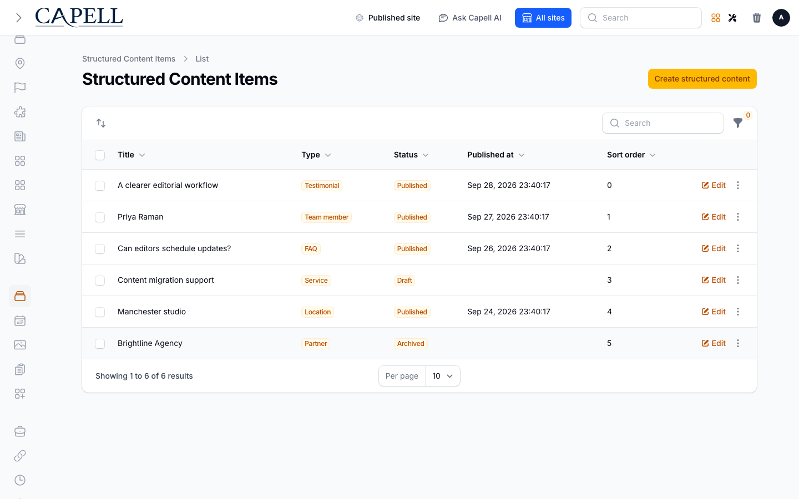
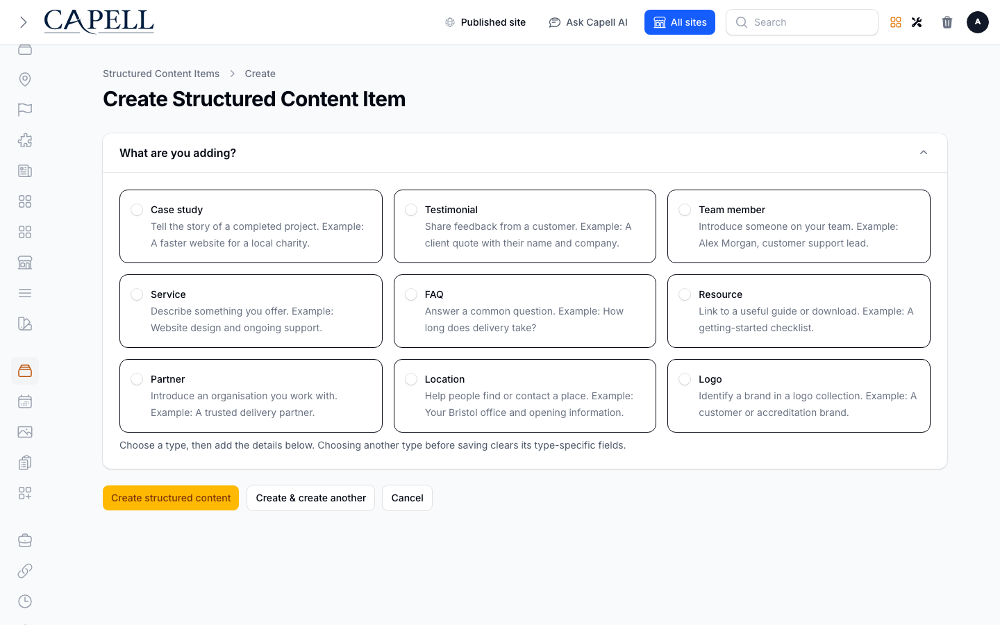

# Structured Content Library

<!-- prettier-ignore-start -->

## What It Does

Structured Content Library stores reusable case studies, testimonials, team members, services, FAQs, resources, partners, locations, and logos as portable records.

- **Price and availability:** Check current availability and price on the [Capell Marketplace listing](https://capell.app/extensions/structured-content-library).
- **Licence:** Check the licence terms on the [Capell Marketplace listing](https://capell.app/extensions/structured-content-library).
- **Requires:** `PHP ^8.4`, `capell-app/admin ^1.0.66`, `capell-app/core ^1.0.75`, `filament/forms ^5.10.2`, `filament/support ^5.7.6`, `lorisleiva/laravel-actions ^2.8`, `spatie/laravel-data ^4.5`, `spatie/laravel-package-tools ^1.14.1`, `ueberdosis/tiptap-php ^2.2`.
- **Install:** `composer require capell-app/structured-content-library`.

Editors maintain structured items in one admin resource. Content Sections and themes receive hydrated public data without querying models from public views.

## Who It Is For

**For developers:** Typed data and adapter contributions provide a package boundary for public records, with portable HTML checks and caching handled before rendering.

**For teams:** Teams can maintain one approved record for repeated people, services, proof, or reference content and reuse it across supported packages.

## Quick Start

1. Install the package: `composer require capell-app/structured-content-library`.
2. Open the package admin surface at `/admin/structured-content-library/structured-content-items` and confirm Structured Content Library is available.

## Configure

This extension works without configuration. There is nothing to set after install.

## Limits And Pitfalls

- Install the required Capell packages at the versions in `composer.json`: `capell-app/admin ^1.0.66`, `capell-app/core ^1.0.75`.
- Run migrations before opening package resources or public routes.
- Custom write integrations must preserve invalidation for `structured-content-library` cache tags.

## Screens And Workflow

- Structured content item list (admin).
- Structured content create form (admin).
- Structured content reusable item edit form (admin).
- Structured content testimonial public render (frontend).
- Structured content type variation (admin).
- Structured content empty state (admin).
- Structured content item list with admin sidebar menu open (admin).

## Install Impact

- Required packages: `capell-app/admin`, `capell-app/core`.
- Admin navigation: declares `admin-resource: StructuredContentItemResourceContribution`; each Filament page or resource controls its own navigation visibility.
- Admin/editor extensions: none declared.
- Permissions: `ViewAny:StructuredContentItem`, `View:StructuredContentItem`, `Create:StructuredContentItem`, `Update:StructuredContentItem`, `Delete:StructuredContentItem`; access also governed by package policies: `StructuredContentItemPolicy`.
- Public routes: none declared.
- Database changes: package migrations are declared.
- Config: no package config files.
- Settings: no package settings declared.
- Queues or schedules: none declared.
- Cache tags: `structured-content-library`.
- Commands: console command classes detected: `SeedStructuredContentScreenshotFixtureCommand`.

## Troubleshooting

| Symptom | Likely cause | Check | Fix |
| --- | --- | --- | --- |
| Package surface is missing after install | Provider or manifest is not loaded | Confirm `capell.json`, package `composer.json`, and provider registration | Reinstall the package, refresh Composer autoload, and clear host caches |
| Admin screen or command fails on missing table | Package migrations have not run | Check the tables listed in `Data Model` | Run host migrations and rerun the focused package test |

## Upgrading

No manual steps between minor versions.

Read [CHANGELOG.md](CHANGELOG.md) before upgrading.

## Next Steps

- [Package docs](docs/README.md)
- [Overview](docs/overview.md)
- [Worked extension examples](docs/extension-contracts.md)
- [Troubleshooting](#troubleshooting)
- [Developer reference](docs/reference.md)
- [Marketplace assets](docs/assets/marketplace/)
- [Capell content language plan](../../docs/CONTENT_LANGUAGE_PLAN.md)
- [Capell documentation design system](../../docs/DESIGN_SYSTEM.md)
- [Capell and package ERD notes](../../docs/erd/capell-and-package-erds.md)
- Related packages: [Content Sections](../content-sections/README.md), [Foundation Theme](../theme-foundation/README.md).

<!-- prettier-ignore-end -->
