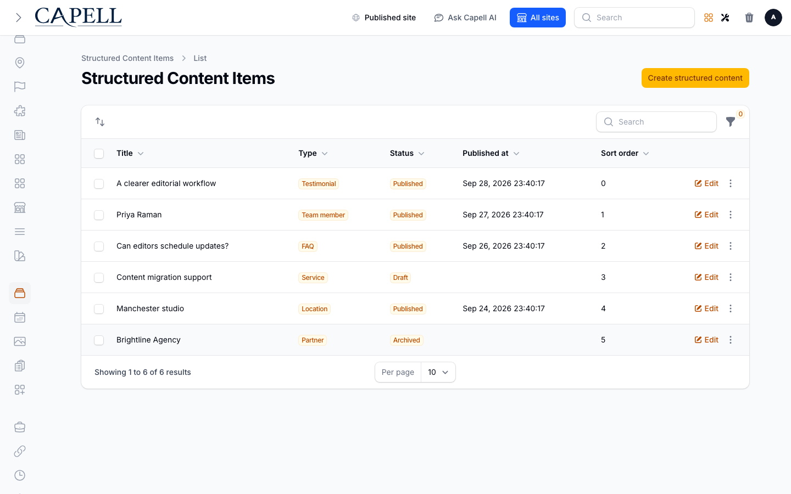
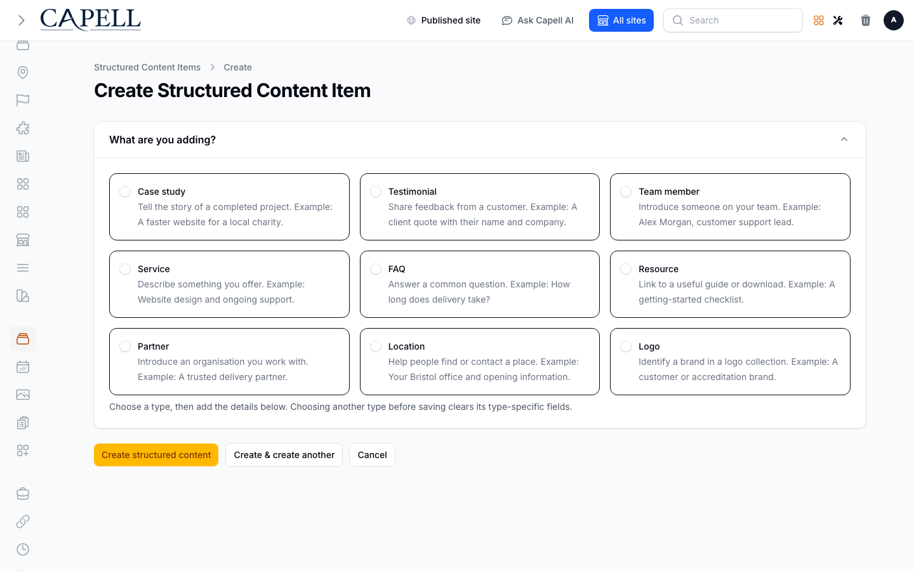

# Structured Content Library

<!-- prettier-ignore-start -->

Your editors can keep content that turns up on several pages, such as a testimonial or a team profile, as a single record and edit it once. Structured Content Items sits in the Website group of the admin menu and holds nine kinds of record, such as testimonials, FAQs, team members and locations. Each kind has its own fields.

Records show on a page once a developer has added them to your theme or a section. A record can carry a translation for each site language, and records with a picture or logo show it with its alt text.

Every record starts as a draft. Publish it now, or publish it with a later date and it becomes available from then. Give it an end date and it leaves the site at that moment. Each published change is kept in the revision history when Publishing Studio is installed, and you can restore an earlier version. A record belongs to one site or to all of them. Global administrators change shared records, while an editor limited to one site changes only that site's. Drafts and archived records never reach the site, and the Preview saved content button shows you the saved values.

- **Price and availability:** Check current availability and price on the [Capell Marketplace listing](https://capell.app/marketplace/extensions/structured-content-library).
- **Licence:** Check the licence terms on the [Capell Marketplace listing](https://capell.app/marketplace/extensions/structured-content-library).
- **Requires:** `PHP ^8.4`, `capell-app/admin ^1.0.78`, `capell-app/core ^1.0.79`, `filament/forms ^5.10.2`, `filament/support ^5.7.6`, `lorisleiva/laravel-actions ^2.8`, `spatie/laravel-data ^4.5`, `spatie/laravel-package-tools ^1.14.1`, `ueberdosis/tiptap-php ^2.2`.
- **Install:** `composer require capell-app/structured-content-library:@beta`.

## Quick Start

1. Install the package: `composer require capell-app/structured-content-library:@beta`.
2. Open the package admin surface at `/admin/structured-content-library/structured-content-items` and confirm Structured Content Library is available.

## For Developers

Typed data and adapter contributions provide a package boundary for public records, with portable HTML checks and caching handled before rendering.

## Configure

- **Configuration files:** `config/capell-structured-content-library.php`.
- **Commands:** `php artisan structured-content-library:invalidate-due-caches`.

## Limits And Pitfalls

- Install the required Capell packages at the versions in `composer.json`: `capell-app/admin ^1.0.78`, `capell-app/core ^1.0.79`.
- Run migrations before opening package resources or public routes.
- Keep the host Laravel scheduler running so package-registered schedules can execute: `structured-content-library:invalidate-due-caches (everyMinute; package registered)`.
- Custom write integrations must preserve invalidation for `structured-content-library` cache tags.

## Screens And Workflow

- Structured content item list (admin).
- Structured content create form (admin).
- Structured content reusable item edit form (admin).
- Structured content testimonial public render (frontend).
- Structured content type variation (admin).
- Structured content empty state (admin).
- Structured content item list with admin sidebar menu open (admin).

## Install Impact

- Required packages: `capell-app/admin`, `capell-app/core`.
- Admin navigation: declares `admin-resource: StructuredContentItemResourceContribution`; each Filament page or resource controls its own navigation visibility.
- Admin/editor extensions: none declared.
- Permissions: `ViewAny:StructuredContentItem`, `View:StructuredContentItem`, `Create:StructuredContentItem`, `Update:StructuredContentItem`, `Delete:StructuredContentItem`; access also governed by package policies: `StructuredContentItemPolicy`.
- Public routes: none declared.
- Database changes: package migrations are declared.
- Config: `config/capell-structured-content-library.php`.
- Settings: no package settings declared.
- Queues or schedules: scheduled commands `structured-content-library:invalidate-due-caches (everyMinute; package registered)`.
- Cache tags: `structured-content-library`.
- Commands: `structured-content-library:invalidate-due-caches`.

## Troubleshooting

| Symptom | Likely cause | Check | Fix |
| --- | --- | --- | --- |
| Package surface is missing after install | Provider or manifest is not loaded | Confirm `capell.json`, package `composer.json`, and provider registration | Reinstall the package, refresh Composer autoload, and clear host caches |
| Admin screen or command fails on missing table | Package migrations have not run | Check the tables listed in `Data Model` | Run host migrations and rerun the focused package test |
| Background work does not run | Queue worker or declared schedule is not active | Check the jobs and scheduled commands listed in `Technical Shape` | Start the queue worker or host scheduler, then run the focused command or package test |

## Upgrading

No manual steps between minor versions.

Read [CHANGELOG.md](CHANGELOG.md) before upgrading.

## Next Steps

- [Package docs](docs/README.md)
- [Overview](docs/overview.md)
- [Worked extension examples](docs/extension-contracts.md)
- Configuration files: [`config/capell-structured-content-library.php`](config/capell-structured-content-library.php).
- [Troubleshooting](#troubleshooting)
- [Developer reference](docs/reference.md)
- [Marketplace assets](docs/assets/marketplace/)
- [Capell content language plan](../../docs/CONTENT_LANGUAGE_PLAN.md)
- [Capell documentation design system](../../docs/DESIGN_SYSTEM.md)
- [Capell and package ERD notes](../../docs/erd/capell-and-package-erds.md)
- Related packages: [Content Sections](../content-sections/README.md), [Publishing Studio](../publishing-studio/README.md), [Foundation Theme](../theme-foundation/README.md).

<!-- prettier-ignore-end -->
